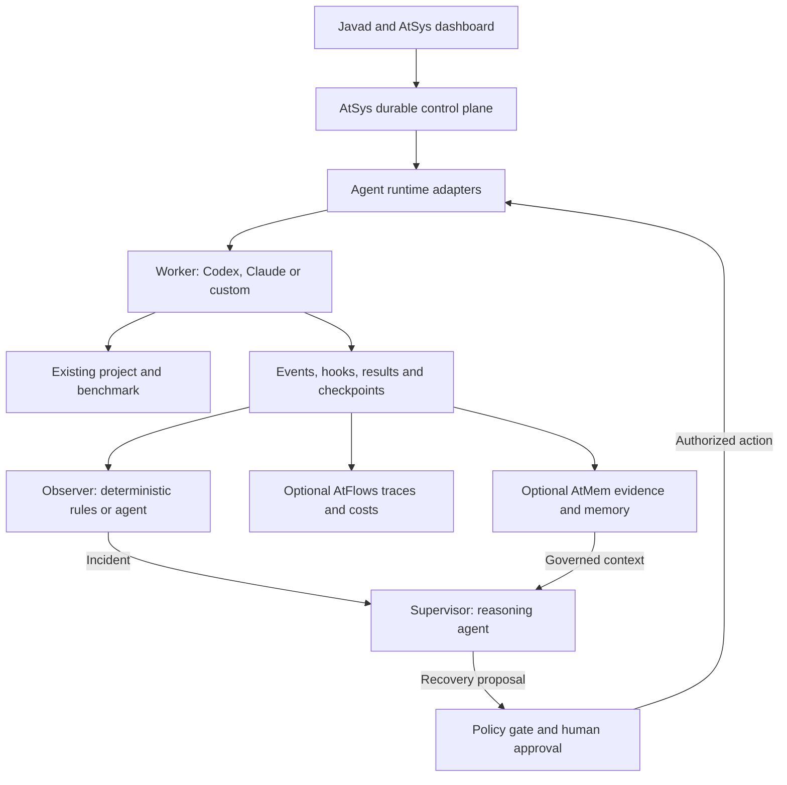

AtSys is a project-attachable supervision and control framework for long-running coding agents. Javad can add AtSys to an existing repository and delegate a six-hour benchmark or software-building task to a Worker such as Codex or Claude Code. AtSys monitors progress with configurable Observers, escalates problems to Supervisors, applies authorized recovery, and exposes live status, evidence, costs and validated results in a Headlamp-inspired dashboard. Worker, Observer and Supervisor are provider-independent roles: Codex, Claude Code, Grok Build, GitHub Copilot, Muse Code, AtBot or a custom agent may fill any role through a compatible adapter. Human approval remains the last escalation boundary. AtMem and AtFlows are optional; Kubernetes is not required.

# Architecture



The control plane is deterministic infrastructure: it owns task IDs, leases, state transitions, retries, deadlines, budgets, incident records, approvals, and audit history. A model may interpret evidence and propose recovery, but must not be the only place where state or authorization exists. Kubernetes is an optional execution substrate, not a dependency of the provider-neutral agent contract.

# Add AtSys to any project

The primary product is an unobtrusive supervisory layer around existing coding agents, not a new coding model or an application framework. It should install locally, work against an existing Git repository, preserve existing source and tool settings, and expose a local web dashboard. It must not require Kubernetes, Docker, AtMem, AtFlows or migrating project code. A user can remove AtSys without disabling their normal Codex or Claude workflow.

## One-project setup

1. Select a repository and existing task. Detect Git branch, installed agent providers, available authentication, OS capabilities and optional AtMem/AtFlows companions.

2. Configure one or more Workers, Observer rules or models, a reasoning-capable Supervisor, and permissions. The simplest preset is one Codex or Claude Worker, deterministic Observer and optional Supervisor.

3. Set objective completion checks: benchmark command, timeout, artifacts, exit-code rules, expected result format and numerical thresholds where applicable.

4. Choose observe-only or allowlisted recovery, cost budgets and optional alerts. Connect AtMem (off/shadow/active) and AtFlows only if wanted.

5. Start an AtSys-managed run and open its dashboard. The Worker continues building or benchmarking the project through its native coding agent.

The first-run wizard should take three primary choices: **project, coding agent, task**. Advanced role assignments and integrations belong in expandable Settings. A setup doctor checks runnable providers and their actual capabilities, validates configuration, and reports permission or port problems before the task starts.

## Proposed CLI experience

- **atsys init** — creates an opt-in project configuration without rewriting source, Git hooks or provider credentials.

- **atsys run** — starts a managed coding-agent or benchmark task with an objective result check.

- **atsys dashboard** — opens the browser console.

- **atsys status** — prints a concise status and dashboard address.

- **atsys stop** — requests a controlled stop with a recorded receipt.

- **atsys doctor** — diagnoses providers, connectors, permissions and telemetry gaps.

- **atsys uninstall** — detaches the framework while preserving project-owned data unless the user explicitly chooses removal.

These are target commands for implementation, not currently released AtSys commands.

## Sessions and portability

Start coding sessions under the selected CLI or SDK adapter when possible. Attach to an already running agent only if that product exposes a supported session protocol; a generic terminal cannot be retrospectively controlled with full hooks and resume semantics. Where a provider has no native resume, restart from a documented project checkpoint or create a new session with validated state and an approved task summary. Never label this native resume. Preserve working-tree diffs, branch state, artifacts, run IDs, tool side-effect receipts, and the user's existing provider authentication.

The control plane manages durable state, leases, retry budgets, supervisor proposals, independent policy checks and approvals. Losing an Observer or Supervisor process must not lose the benchmark record. Worker progress comes from verifiable signals, not a process-running label alone. An AtSys task is **completed** only after required results or artifacts pass declared validators; otherwise it is failed, blocked or awaiting review.

## Local-first packaging

| Piece | Local default | Optional extension |
| - | - | - |
| AtSys runtime | Installable process with durable local SQLite state | Shared PostgreSQL service for teams |
| Dashboard | Browser UI on local loopback; open automatically | Authenticated remote/team UI |
| Worker/Observer/Supervisor | Provider-native CLI or SDK adapters | Remote isolated execution |
| Evidence | Local artifact store, indexed receipts and log references | Remote object store |
| AtMem | Off by default; optional governed memory | Independently managed memory service |
| AtFlows | Off by default; optional telemetry ingestion and native dashboard link | Shared OTLP collector |
| Kubernetes/Headlamp | Not required | Headlamp opened as a separate cluster diagnostic view |

# Runtime portability requirements

A runtime adapter converts a provider's native sessions, hooks, messages, exit statuses, and permission requests to one platform contract. Vendor-specific logic stays inside the adapter. Role policies and incident handling consume the normalized contract only.

| Runtime | Preferred integration interface | Notes |
| - | - | - |
| OpenAI Codex | Codex app-server or SDK; exec for bounded tasks | Stream events, handle approvals, and manage sessions through the documented interface |
| Claude Code | Claude Agent SDK or noninteractive CLI | Session events, tool hooks, permissions, and structured output |
| Grok coding agent | Grok Build headless CLI or Agent Client Protocol | Streaming JSON, sessions, hooks, and ACP transport |
| GitHub Copilot coding agent | Copilot SDK backed by Copilot CLI | JSON-RPC session events, hooks, approvals, and resume; distinguish this from the GitHub-hosted cloud coding agent |
| Meta Muse Code | Muse Session Protocol, TypeScript SDK, or headless CLI | Versioned protocol, local session control, event logs, and approval handling |
| Custom AtBot or other custom agent | Pydantic AI SDK, HTTP, gRPC, message queue, or process adapter | Must implement the common lifecycle and event contract |

The provider catalog is extensible. No role may depend on a specific provider name. Multiple instances of different providers can run concurrently, and a provider may fill multiple roles if each instance has separate identities and permissions.

# Common agent adapter contract

Required for a supported runtime: discover capabilities; start a task; receive status, terminal result, and at least basic logs; cancel or terminate through a controlled execution boundary; report the native session ID; and map failures to normalized events.

Optional capabilities: live tool hooks, streamed model and tool events, native pause, message steering, native session resume, checkpoint export, provider-side reasoning-effort configuration, usage accounting, and approval callbacks.

If a capability is missing, the console must show it as unavailable. A process wrapper may provide exit codes, timeouts, heartbeats, and forced termination, but it cannot invent native tool hooks or reconstruct missing history. If native resume is absent, a restart is allowed only from an application-owned checkpoint and only when external effects have been reconciled.

A normalized event should include schema version, event ID, timestamp, run and task IDs, agent and role IDs, adapter and native session IDs, event type, severity, trace and parent span IDs, progress/checkpoint IDs, evidence references, and a redacted payload. Preserve vendor-specific fields separately as extensions.

The platform should support three compatibility levels: basic execution and coarse status; instrumented session events; and full interactive supervision. Safety-critical roles can require a minimum level.

# Role behavior and isolation

## Worker

Executes long-running tasks, scripts, coding changes, tests, data collection, and tool calls. Emits progress, heartbeats, checkpoints, artifacts, errors, and final outcomes. Runs in an isolated workspace with bounded tool access and explicit idempotency keys for external writes.

## Observer

Reads normalized events, logs, heartbeats, and evaluation results. Uses deterministic rules first and an optional small or low-effort model for ambiguous interpretation. Can create incident reports and evidence references but cannot mutate worker runtime configuration or grant itself permissions. Observer failure must not interrupt the durable workflow engine.

## Supervisor

Uses a configurable reasoning-capable agent to investigate incidents, retrieve authorized evidence, select versioned recovery skills, and propose an intervention. May be Codex, Claude, Grok, Copilot, Muse, AtBot, or a custom agent. The supervisor receives read access and proposal tools, not direct unrestricted shell or cluster mutation permissions.

## Human operator

Receives escalations through a configured channel when a high-risk action, repeated failure, low-confidence diagnosis, or policy breach requires intervention. Can approve, reject, amend, pause, or terminate a run. Approvals and denials are durable and auditable.

# Recovery and policy

The observer creates an incident on structural failure, timeout, stalled heartbeat, failed evaluation, excessive repetition, or defined log patterns. Keyword matching such as “exception” is only a hint; the detector should prefer typed error events and contextual evidence.

The recovery controller can perform pre-authorized deterministic retries and backoff without an LLM. The supervisor is invoked when a diagnosis or plan adjustment requires reasoning. It returns a structured proposal containing incident ID, evidence IDs, action type, exact target and parameters, confidence, expected impact, rollback method, and verification plan.

The controller evaluates proposals against an independent policy engine. Allowlisted bounded operations may run automatically, while destructive writes, widening permissions, or changes exceeding configured budgets require human approval. Every action gets an operation ID, concurrency lock, attempt limit, audit receipt, and post-action verification. Reconcile unknown external outcomes before replay to avoid duplicate side effects.

If recovery fails repeatedly, trip a circuit breaker and escalate rather than entering an unbounded repair loop.

# Optional AtMem integration

AtMem is an opt-in companion to the control plane, not the workflow scheduler, authorization engine for operational actions, or replacement for the incident database. Its existing design provides governed, scoped agent memory, source-linked evidence, provenance, lifecycle controls, context delivery, and audit inspection. AtBot may separately act as a runtime through the custom-agent adapter; its memory-assistance role does not grant operational authority.

Three modes:

- Off: workers, observers, supervisors, and the console operate using durable workflow records and ordinary telemetry; no AtMem dependency.

- Shadow: the integration submits supported source episodes, evidence references, candidate memories, and disposition receipts for review; no context is automatically injected.

- Active: AtMem authorizes purpose-scoped retrieval and injects bounded, source-linked context into a role session through the gateway at designated lifecycle points.

Retain two distinct classes of information. Evidence includes raw or redacted tool outputs, errors, trace IDs, artifacts, evaluation records, worker configuration snapshots, supervisor proposals, approval receipts, and verified outcomes. Learned memory includes source-linked failure patterns, project decisions, successful recovery procedures, failed strategies, and environment-specific constraints. Evidence does not automatically become an accepted memory or an established fact.

Use immutable artifact storage for large raw data and retain protected pointers, digests, provenance, scope, retention, and access metadata in the evidence system. AtMem governs admission, quarantine, supersession, recall, correction, and forgetting. Agents and supervisors propose memory operations; only AtMem decides what is admitted or delivered. Never cross workspace, user, or tenant boundaries without explicit authorization.

The gateway requests an AtMem context pack before a worker, observer, or supervisor turn when the role is permitted to recall. Attach citation/evidence IDs, scope, a per-turn token budget, and a sufficiency disposition. The supervisor may use past verified incidents to inform a new proposal, but current telemetry and policy override an old remembered recovery recipe. Memory failure must not block safety-critical stop/cancel functions; fail closed for unauthorized recall, report degraded memory, and keep execution state intact.

AtFlows can supply optional observation/evidence views, but the agent control plane retains its own source of truth for execution and incident state.

# AtSys dashboard and console

| Screen | Primary graphics and decisions |
| - | - |
| Overview | Run-health cards, active roles, progress timeline, incidents, approvals, last verified result and spend versus budget |
| Projects | Repo cards, branch, last task, configuration, memory scope, spending limits and history |
| Fleet | Headlamp-style sortable agent table and tiles: role, runtime, model, live task, heartbeat, capabilities, health, permission |
| Runs | Worker/Observer/Supervisor swimlanes, chronological hooks, collapsible logs, evals, checkpoints, diffs, artifacts and final validator |
| Incidents and recovery | Severity queue, error trends, detection evidence, supervisor diagnosis, proposed fix, retries, verification and circuit breaker |
| Approvals | Requested action, exact command or diff, affected scope, risks, allow/deny buttons and audit receipt |
| Costs | Line chart by hour/day, stacked costs by provider/model/role, input/output tokens, budget gauge, forecast and unpriced usage |
| Memory | AtMem status, mode, accepted and quarantined memory, recall decisions, evidence provenance, scope and deep links |
| Observability | AtFlows status, known trace coverage, current session diagnostics, cost-telemetry coverage, native dashboard link |
| AtBot | Companion status, provider/model, proposal count, errors and supported setup/settings link |
| Settings and notifications | Projects, agent adapters, recovery guardrails, skills, evaluator rules, notification channels and connection tests |

The UI must make unavailable provider capabilities explicit. A dashboard indicating that an agent is “running” is not proof that its task is making progress or producing correct output.

## Headlamp-inspired visual design

AtSys needs a purpose-built dashboard with a project selector, left navigation, status badges, searchable tables, drill-down drawers and graphs that lead directly to the underlying evidence. Headlamp is a visual reference and, when Kubernetes is used, an optional external link. Do not make Headlamp or Kubernetes a prerequisite for running AtSys.

### Default project overview

| Location | Content |
| - | - |
| Header | Project and Git branch; selected Worker provider; search; notifications; dashboard connection state |
| First row | Running agents; healthy/stalled; open incidents; approvals waiting; verified task completion; spend/budget |
| Main panel | Agent-task timeline or topology showing Worker, Observer and Supervisor activities and each intervention |
| Right rail | Active incidents, supervisor proposals, approval prompts and human acknowledgements |
| Lower left | Filtered live log stream and hook/evaluation events with source links |
| Lower right | Spend trend, AtMem/AtFlows status, and recent benchmark-result history |

Every displayed status needs a timestamp. Use three-way distinctions such as healthy / degraded / unknown. Highlight stale data and unsupported provider capabilities. Provide pause for live logs, event-level search, last 24 hours / 7 days / 30 days, and links from every chart to the relevant run/incident. Use both text and shape, not color alone.

### Long-running benchmark dashboard

The run header should show task objective, command or workflow, repository commit/branch, assigned Worker runtime, elapsed time, last heartbeat, stage/progress if measurable, expected artifact, timeout and remaining budget. A progress percentage is shown only with a real unit of work. Below: Worker events alongside Observer checks and Supervisor interventions. Expose raw exception with redaction, number of retries, restart source, exact checkpoint and each proposed/authorized action. A result card distinguishes **validated pass**, **validated fail**, **incomplete**, **aborted** and **not yet evaluated**. Completion requires a validator receipt and an output artifact/checksum where applicable.

### Cost screen and guardrails

Use stable run/session/span IDs to correlate AtFlows OpenTelemetry records with provider-native usage. De-duplicate invocation events so a single call is not charged twice when both sources observe it. Calculate per-provider, model, project, role, run and day. Track input/output tokens, provider-reported charges where available, estimated API cost with effective-dated model rates, subscription fees entered by users, tool/compute charges and unattributed usage. **Unknown cost must not be displayed as zero.** Cost cards include rate provenance, pricing date, currency, collection coverage and drill-through source events. Budget alerts should distinguish 80%-used warnings, per-run ceilings and runaway retry spending; only future locally controlled calls can be blocked.

### AtMem, AtFlows and AtBot integration

**AtMem:** show off/shadow/active mode, health, governed memory admission, quarantines, supersession, recall decisions, traceable evidence references, context tokens and project scope. Provide verified native links to Sessions, Memory, Decisions, Audit and Settings. Raw or large evidence should remain in artifact storage with protected pointers and digests when appropriate; memory acceptance is separate from a tool-result capture.

**AtFlows:** show a small summary of traces, telemetry completeness and known cost records when accessible. Open its native Activity, Timeline and Analytics dashboard for investigation. AtFlows has its own telemetry database; AtSys keeps authoritative task state, incidents and action receipts. Installing the companion alone does not mean events are being collected: require a working OTLP/proxy integration before showing healthy instrumentation.

**AtBot:** show installed/configured/healthy status, model/provider, memory proposal outcomes and own invocation costs when observable. Link to supported AtMem-managed setup or settings. Do not assume AtBot has a separately served native dashboard. Treat its custom-agent runtime interface, if selected for Worker/Observer/Supervisor, as independent from its AtMem memory-assistance function.

Deep links should be resolved from actual local status discovery such as AtMem/AtFlows status output, never made up from fixed ports. Respect each native dashboard's authentication and user access; shortcuts do not grant permissions. When a companion is off, all core AtSys screens still work and its tile says unavailable.

### Configurable alerts

The in-app notification center always records incidents. Optional sound plays only after the browser or desktop app receives permission and the user enables it. Telegram is disabled by default; setup takes an opt-in bot token, destination chat ID and test-message confirmation via the Telegram Bot API. Future email, Slack, desktop tray and webhooks use the same notification adapter interface.

Rules select project, severity, event type, quiet hours and destination. Alerts must be deduplicated, rate-limited, acknowledged and retried with a delivery receipt. A message contains redacted project/incident IDs, severity, brief diagnosis, needed human action and a secure dashboard link, never secrets or raw prompts. Telegram notification alone cannot authorize a recovery; high-risk approval requires an authenticated, policy-checked action.

### Setup and integration cards

Every connector has one of: not installed, needs configuration, healthy, degraded, offline or permission denied. Provide a one-click connection test and clear fix instructions. The AtSys dashboard should support desktop and mobile widths, with responsive fleet and run views; long tables retain filtering and keyboard access.

# Illustrative deployment profile

```yaml
# Illustrative AtSys design format, not a released schema
project:
  root: .
  preserve_source: true
dashboard:
  enabled: true
  bind: 127.0.0.1
  default_view: overview
agents:
  worker-a:
    role: worker
    runtime: codex  # can be claude-code, muse-code, copilot, grok, atbot
    profile: coding
  observer-a:
    role: observer
    runtime: muse-code
    reasoning_preference: low
    permissions: read-only
  supervisor-a:
    role: supervisor
    runtime: atbot
    reasoning_preference: high
    permissions: propose-only
tasks:
  benchmark:
    command: ./scripts/benchmark.sh
    timeout_hours: 8
    result_artifact: results/benchmark.json
    validator: benchmark-json-and-thresholds
memory:
  provider: atmem
  mode: shadow  # off, shadow or active
  scope: project
observability:
  atflows:
    enabled: false
    native_dashboard_url: auto
costs:
  currency: USD
  daily_budget: 20
  alert_percent: 80
  unknown_price: unknown
notifications:
  in_app: true
  sound: {enabled: false, severity: critical}
  telegram:
    enabled: false
    bot_token_env: ATSYS_TELEGRAM_BOT_TOKEN
    chat_id_env: ATSYS_TELEGRAM_CHAT_ID
    severity: critical
  deduplicate_seconds: 300
```

This is a proposed platform configuration, not a current CLI format. The user can swap the runtime of any role without modifying the incident schema or recovery policy. Reasoning-effort preferences apply only if the selected runtime exposes an equivalent control; otherwise the adapter must report the effective mode.

# Acceptance tests

1. Start Codex as Worker, Muse Code as Observer, and AtBot as Supervisor; then swap all three providers without changing role logic.

2. Run two providers concurrently and inspect their events in the same execution timeline without losing native session IDs.

3. Simulate a worker crash, a silent hang, a typed tool exception, and a failed output evaluation; distinguish and escalate each correctly.

4. Stop the Observer and Supervisor processes; demonstrate that workflow state, leases, recovery limits, and incidents survive.

5. Show a bounded automatic restart from an external checkpoint, then an unsafe recovery proposal that waits for human authorization.

6. Disable AtMem and demonstrate identical core execution and recovery, with memory features marked unavailable.

7. Enable AtMem shadow mode, retain exact incident evidence and provenance, and verify that no unapproved context reaches agents.

8. Enable governed recall for one workspace; prove that an unrelated workspace cannot retrieve its evidence or memories.

9. Mark a failed recovery as unverified; prove that it is not promoted into a trusted recovery recipe without review.

10. Record exact action receipts, checkpoint IDs, policy decisions, and an auditable result for every intervention.

11. Add AtSys to an existing local repository without rewriting its source, provider configuration or Git hooks; run with only Codex installed and no Kubernetes, AtMem or AtFlows.

12. Delegate a simulated six-hour benchmark with objective output validation. Demonstrate live Worker, Observer and Supervisor timelines and mark completion only after validator success.

13. Crash the Worker halfway through. Show exact partial progress, error evidence, safe checkpoint or restart state, a bounded recovery and final verification; do not lose history if Observer and Supervisor restart.

14. Start a managed Claude Code run, swap to Codex for a new run, and distinguish supported native resume from restart with a task summary where capabilities differ.

15. Connect AtFlows and native usage events to one invocation; de-duplicate its cost, show price provenance, separate paid and estimated cost, and display unknown when pricing is missing.

16. Disable AtMem, AtFlows and AtBot and show core AtSys status, incidents, approvals and agent logs with honest unavailable tiles.

17. Trigger a critical incident; verify opt-in sound, Telegram test routing, redaction, grouping, acknowledgement, delivery history and no operational authority in the Telegram message.

18. Follow a memory tile to native AtMem and a trace tile to native AtFlows using discovered links; preserve native authentication and permissions.

# Relevant implementation sources

- [Codex app-server, SDK and exec](https://developers.openai.com/blog/codex-as-a-platform)

- [Claude Agent SDK and hooks](https://code.claude.com/docs/en/agent-sdk/overview)

- [Grok Build headless scripting and ACP](https://docs.x.ai/build/cli/headless-scripting)

- [GitHub Copilot SDK session events](https://docs.github.com/en/copilot/how-tos/copilot-sdk/features/streaming-events)

- [Meta Muse Code session protocol](https://dev.meta.ai/docs/muse-code)

- [AtMem documentation](https://atmem.ai/docs)

- [Temporal durable AI workflows](https://docs.temporal.io/ai)

- [Open Policy Agent tool-call policies](https://www.openpolicyagent.org/docs/agent-tool-calling)

# Dashboard and companion implementation references

- [Headlamp UI and extensible dashboards](https://headlamp.dev/docs/latest/development/plugins/)

- [AtMem dashboard for Sessions, Memory, Decisions and Audit](https://atmem.ai/docs/reference/dashboard)

- [AtFlows observability and its Activity, Timeline and Analytics screens](https://atmem.ai/docs/getting-started/atflows)

- [AtBot intelligence companion and setup](https://atmem.ai/docs/getting-started/atbot)

- [AtMem and AtFlows status URL discovery](https://atmem.ai/docs/reference/cli)

- [OpenTelemetry GenAI metrics and usage](https://opentelemetry.io/blog/2026/genai-observability/)

- [Telegram Bot API](https://core.telegram.org/bots/api)
