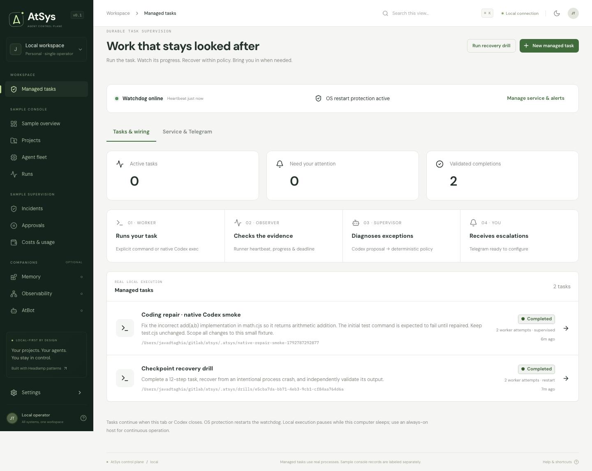

# AtSys

A local control plane for **any coding work you delegate**: implementing features, fixing bugs, refactoring, testing, building, migrating, reviewing, or running scripts. AtSys keeps the task, automation, observation, recovery policy, and escalation visible after the originating Codex conversation or terminal closes.

The benchmark failure motivated this project; benchmarks are not its domain model.



## Start

Install the Python release (Python 3.10+):

```sh
python -m pip install --upgrade atsys
cd /path/to/your/project
atsys init
```

Then open Codex in that repository and say:

```text
$atsys Implement [my objective], preserving unrelated changes and verifying [acceptance criteria].
```

The packaged skill handles repository inspection, planning, task configuration, independent validation, two bounded retries, supervisor/repair policy, watchdog checks and verified handoff to a separate worker. You provide the objective and constraints. No pasted setup prompt or absolute AtSys checkout path is needed. Reopen Codex if it was already running when the skill was installed.

`atsys init` installs the project skill, starts the macOS watchdog service and launches the bundled dashboard. `atsys ui` opens it again; `atsys task list` shows managed work. The dashboard starts at **http://127.0.0.1:4310**, choosing another free port if a different instance is there. Always use the reported URL. Installed state lives in `~/.local/share/atsys`, independent of the package and repository. `ATSYS_DATA_DIR` overrides it.

The wheel includes the backend and dashboard; its Python dependency supplies Node 24. No npm or source checkout is required at runtime. Codex CLI and its existing login are needed for Codex workers, supervisors and repairs. Version 0.2.0 is available on [PyPI](https://pypi.org/project/atsys/0.2.0/) and as a [GitHub release](https://github.com/aetna000/atsys/releases/tag/v0.2.0). See [packaging, verification and release instructions](docs/PACKAGING.md).

## Develop AtSys from source

Node 22.16+ and npm are required for development.

```sh
npm install
npm run dev
```

Open **http://127.0.0.1:5173**. For a built application, run `npm run build` then `npm start` and open **http://127.0.0.1:4310**. `ATSYS_PORT` and `ATSYS_DATA_DIR` override the local API port and private data directory.

The primary **Managed tasks** page runs real workloads. The older resource-console screens are explicitly grouped as samples. No Docker, Kubernetes, AtMem, or AtFlows is required.

## Delegate work

Use **New managed task** to configure:

- Objective, project directory, execution plan and constraints.
- A Codex coding worker (model and reasoning effort), or explicit command arguments.
- An independent acceptance command: tests, builds, lint, custom assertions, or any executable check. Required artifact paths are optional and their contents are hashed.
- Attempt deadlines, total task lifetime, runner heartbeat deadline, output inactivity window, and optional application progress file.
- Notify-only, bounded restart, or automatic Codex supervision. Optional repair permission launches a separate bounded Codex worker with workspace-write access.
- Retry delay/limits, supervisor model/effort/call limit/deadline, and repair deadline.

AtSys launches the worker, checks it, and runs the independent validator. Failed execution or validation opens an incident. The supervisor diagnoses read-only and proposes restart, repair, or human escalation. Deterministic policy decides whether the action is permitted. A repair never bypasses the configured acceptance command.

**Run recovery drill** exercises a harmless local task that deliberately fails once, saves progress, resumes, and validates its result. It does not invoke a paid model or touch other projects.

## CLI from Codex or your terminal

```sh
# Submit a coding task and immediately return to the caller.
npm run atsys -- run --project /absolute/repo --worker codex \
  --objective "Implement the requested feature, preserving unrelated changes" \
  --validation '["npm","test"]'

# Supervise an existing command.
npm run atsys -- run --project /absolute/repo --name "Build and check" \
  --recovery restart --timeout 1800 -- npm run build

# Full configuration (missing fields receive documented defaults).
npm run atsys -- task submit --config examples/coding-task.json
npm run atsys -- task list
npm run atsys -- task show task-ID
npm run atsys -- task stop task-ID
npm run atsys -- task retry task-ID
```

Update the example's working directory and objective before submitting it. JSON argv is passed directly with `shell:false`; use an explicit shell executable only when your task requires one. Generic commands run as your local user. Exit-code validation is available when sufficient; a custom independent acceptance command is preferred for coding changes. Benchmark JSON remains an optional specialized validator.

`run` and `task submit` persist work and exit. `run --attached` retains the original terminal-owned executor for compatibility. `status`/`stop run-ID` refer to the older sample/basic-run store; `task list`/`task stop task-ID` refer to managed work.

## Make the watchdog durable

```sh
npm run atsys -- service install
npm run atsys -- service status
```

On macOS, this installs a **current-user LaunchAgent** with KeepAlive and login startup. You can also manage it from **Service & Telegram**. The dashboard/API and CLI are not execution owners. Detached runners survive their closure; the OS service restarts a dead watchdog and reconciles existing attempts.

```sh
npm run atsys -- service uninstall
```

Removal disables OS restart protection and leaves a detached watchdog for existing work. Stop individual tasks explicitly before removing their execution environment. Other POSIX platforms can run `node --import tsx server/operations/daemon.ts /absolute/data-directory` under their own service manager; built-in installation currently targets macOS.

A sleeping or powered-off computer cannot execute tasks or send alerts. Use an always-on host for continuous operation; remote access itself is not implemented.

## Telegram

Open **Service & Telegram**, enter a bot token and chat ID, enable the desired event types, save, and explicitly send a test notification. Start a conversation with the bot first. Notifications use a persistent outbox with bounded retries and visible delivery outcomes.

The token is stored separately in a mode-0600 private file and is never returned by the API. Telegram is outbound notification only; it cannot authorize recovery. Delivery is at-least-once: a crash after Telegram accepted a message but before the receipt is saved can produce a duplicate. No notifications are sent until configured and enabled.

## What is durable, and what is bounded

Operational state lives in the data directory's `operations.sqlite` (`~/.local/share/atsys` for pip installs; `.atsys` for source development), with transactional task/attempt/event/outbox changes. Each attempt has a configuration snapshot and process identity. Watchdog ownership is fenced by a durable lease. Runner heartbeats and application progress are distinct. Output inactivity is an optional heuristic, not proof of task progress. Attempts keep up to 32 KB of redacted output; tasks keep the latest 500 events. Full retention/export is future work.

Completion requires the declared check, not an agent's claim. Generic artifact checks prove presence and record content digests; they do not by themselves prove semantic correctness or freshness. The optional benchmark adapter also checks freshness and its result schema. Application checkpoint recovery uses declared resume arguments; arbitrary side effects and native Codex session resume are not automatically reconstructed. Retry-safe commands/checkpoints remain part of task configuration.

Codex uses the installed CLI and native login. No provider authentication files are read by AtSys. Model costs are currently unknown and dollar budgets are not enforced for managed tasks; attempt, call, and time limits are enforced. Generic commands are trusted code. This is a single-user loopback application, not an authenticated team server or sandbox for hostile workloads.

## Verify and review

```sh
npm test
npm run typecheck
npm run build
npx playwright install chromium
npm run test:e2e
npm run format:check
```

- [Active packaging specification](specs/003-python-package/spec.md), [plan](specs/003-python-package/plan.md), [tasks](specs/003-python-package/tasks.md)
- [Durable supervision specification](specs/002-durable-task-supervision/spec.md), [plan](specs/002-durable-task-supervision/plan.md), [tasks](specs/002-durable-task-supervision/tasks.md)
- [Constitution](.specify/memory/constitution.md), [original console specification](specs/001-supervision-console/spec.md)
- [Architecture](docs/ARCHITECTURE.md), [verification report](docs/IMPLEMENTATION.md), [remaining work](docs/ROADMAP.md)
- [Build versus reuse assessment](docs/BUILD-VS-REUSE.md)

GitHub Spec Kit is initialized with the Codex integration. The UI reuses Headlamp's adapted StatusLabel and resource-console patterns, with upstream [license](src/vendor/headlamp/LICENSE), [NOTICE](src/vendor/headlamp/NOTICE), and [attribution](docs/headlamp-research.md) retained. Local fonts include their licenses. The original project brief and existing environment file are preserved; credentials and runtime state are excluded from Git.
